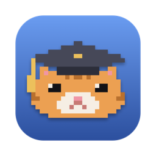

<p align="center">
  
</p>

<h1 align="center">Anduin</h1>

<p align="center">Run Claude Code in several folders at once, side by side, in one window.</p>

---

Anduin is a small terminal multiplexer built for [Claude Code](https://claude.com/claude-code).
The left side is a sidebar of your project folders. The right side is a live
Claude session. Switch between projects without juggling terminal tabs, and keep
several Claude sessions running in the same folder.

```
┌ anduin ─────── 2 running ┐┌ agent-knowledge-workflow ~/Documents/… · #1 ───────┐
│ 1 mac                + × ││                                                     │
│   ▸ start a session      ││   ▐▛███▜▌   Claude Code                             │
│ 2 agent-knowledge…   + × ││  ▝▜█████▛▘  ~/Documents/…/agent-knowledge-workflow  │
│ ▌ ● #1 fix the parser  × ││                                                     │
│   ○ #2 new session  idle ││  > _                                                │
│ 3 genesis-miniapps   + × ││                                                     │
│                          ││                                                     │
│       + Add folder       ││                                                     │
└──────────────────────────┘└─────────────────────────────────────────────────────┘
 C-] prefix  C-] j/k switch dir  C-] s sidebar  C-] [ scroll
```

## Features

- **Folders in a sidebar**: add them with the Finder picker or by typing a path.
- **Several sessions per folder**: start, close and restart Claude sessions independently.
- **Status at a glance**: each session shows *working*, *idle*, *needs you* or *exited*. The bell from
  a session is passed on to you, so the Dock icon bounces when Claude is waiting.
- **Mouse support**: click folders, sessions and the `+` / `×` buttons, and scroll the output.
- **Scrollback** for every session.
- **Theme tint**: recolor Claude's orange to blue, purple, teal and more.
- **Custom mascot**: replace Claude's mascot with your own pixel art, animated if you like.
  The default build ships a graduation kitten.
- **Native macOS app**: `Anduin.app` has its own window, Dock icon and Cmd+Tab entry.

## Requirements

- macOS
- [Rust](https://rustup.rs) (stable)
- Xcode Command Line Tools (`xcode-select --install`), for Swift and the app bundle
- [Claude Code](https://claude.com/claude-code) installed and on your `PATH`

## Install

```sh
git clone git@github.com:Ayyasythz/anduin.git
cd anduin

# The `anduin` command, installed to ~/.cargo/bin
cargo install --path .

# Anduin.app, installed to /Applications (pass another folder to install elsewhere)
macos/build-app.sh
```

## Usage

Open **Anduin.app**, or run it from a terminal:

```sh
anduin                 # open the default folder from the config, if set
anduin ~/work/api .    # add these folders to the list and open the first one
anduin --help
```

Pressing <kbd>Enter</kbd> on a folder starts Claude there. Keystrokes go to Claude
until you press the **prefix key**, <kbd>Ctrl</kbd>+<kbd>]</kbd>.

### Keys

After the prefix <kbd>Ctrl</kbd>+<kbd>]</kbd>:

| Key | Action |
| --- | --- |
| `j` / `k` | next / previous session |
| `s` or `Tab` | toggle focus between the sidebar and Claude |
| `1`–`9` | jump to a folder |
| `c` or `+` | new session in the current folder |
| `x` | close the current session |
| `r` | restart the current session |
| `n` | add a folder with the Finder picker |
| `N` | add a folder by typing its path (`Tab` completes) |
| `d` | remove the folder from the list (files are not touched) |
| `[` | scroll mode: `j`/`k`, `u`/`d`, `g`/`G`, `q` to leave |
| `q` | quit |
| `Ctrl`+`]` | send a literal `Ctrl`+`]` to Claude |

When the sidebar has focus, the same commands work without the prefix. Use
`j`/`k` to move and `Enter` to open. Inside Claude, <kbd>Shift</kbd>+<kbd>PgUp</kbd> /
<kbd>Shift</kbd>+<kbd>PgDn</kbd> also scroll.

In Anduin.app: <kbd>Cmd</kbd>+<kbd>C</kbd> / <kbd>Cmd</kbd>+<kbd>V</kbd> copy and paste,
<kbd>Cmd</kbd>+<kbd>=</kbd> / <kbd>Cmd</kbd>+<kbd>-</kbd> change the font size, and
<kbd>Ctrl</kbd>+<kbd>Cmd</kbd>+<kbd>F</kbd> toggles full screen.

## Configuration

Settings live in `~/Library/Application Support/anduin/config.json`. Set `ANDUIN_CONFIG` to use a different file.
Folders you add are saved there automatically.

```json
{
  "projects": [
    { "name": "api", "path": "/Users/me/work/api" }
  ],
  "default": "~/work/api",
  "command": "claude",
  "prefix": "ctrl-]",
  "tint": "orange",
  "mascot": "cat"
}
```

| Field | Default | Description |
| --- | --- | --- |
| `projects` | `[]` | folders in the sidebar |
| `default` | none | folder opened when Anduin starts without arguments |
| `command` | `"claude"` | command run in each session, e.g. `"claude --continue"` |
| `prefix` | `"ctrl-]"` | prefix key, as `ctrl-<key>` |
| `tint` | `"blue"` | `orange` (Claude's own colors), `blue`, `sky`, `indigo`, `purple`, `pink`, `teal`, `green`, or a hue in degrees |
| `mascot` | Claude's | see below |

### Mascot

`mascot` replaces the Claude mascot at the top of each session. It accepts:

- **A preset name**: `"cat"`, `"robot"`, `"ghost"`, `"frog"`, `"none"` (blank) or
  `"claude"` (keep the original).
- **An image path**, e.g. `"~/Pictures/pet.png"`. It is cropped and reduced to 18×6 pixels.
- **Pixel art**: rows of 18 characters, where `.` is transparent and every other
  character is a color from `colors`:

  ```json
  "mascot": {
    "pixels": [
      "..KKKKKKKKKKKKKK..",
      "..KYOO.KKKK.OO....",
      "...YOOOOOOOOOO....",
      "...YOEEOOOOEEO....",
      "....OOWWPPWWOO....",
      ".....OWWWWWWO....."
    ],
    "colors": { "K": "#464858", "Y": "#ecc05c", "O": "#eca052", "E": "#121216",
                "W": "#f6eee4", "P": "#f096a5" }
  }
  ```

- **An animation**: `"frames"` is a list of `{ "pixels": [...], "ms": 500 }`, played in
  a loop. The optional `"click"` frames play once when you click the mascot.

## How it works

- `src/`: the Rust TUI (ratatui). Each session runs in its own PTY
  ([portable-pty](https://crates.io/crates/portable-pty)) and is emulated with
  [vt100](https://crates.io/crates/vt100), so Anduin can redraw it, tint it and swap the mascot.
- `macos/app/`: the native window, a small AppKit app built on
  [SwiftTerm](https://github.com/migueldeicaza/SwiftTerm), which runs the bundled `anduin-cli`
  through your login shell so `PATH` matches your terminal.
- `macos/icon.swift`: draws the app icon.
- `macos/build-app.sh`: builds both parts and assembles `Anduin.app`.

## Contributing

Pull requests are welcome. If you work with an AI coding agent, point it at
[AGENTS.md](AGENTS.md) (Claude Code loads it automatically through `CLAUDE.md`):
it maps the code and lists how to build, test and verify changes.

## License

[MIT](LICENSE)
